# Ring Vaccination Planner

A planning tool for outbreak response teams. Given a contact network and the confirmed cases, it works out who should be vaccinated so that every risky contact link around the cases is protected, using as few doses as possible. It also gives the public a privacy-safe way to check whether they were exposed at a venue.

Advanced Algorithm, CIA 3 project, ATLAS SkillTech University (2026 to 27).
Team: Bhavya Patel and Tanushree.

See [PROJECT_PLAN.md](PROJECT_PLAN.md) for the full design and [WORK_SPLIT.md](WORK_SPLIT.md) for who built what.

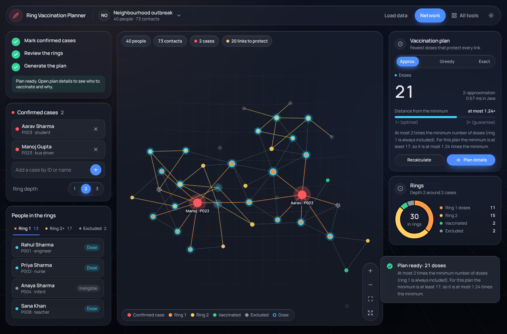

## The problem in one paragraph

Ring vaccination protects the people around each confirmed case: their contacts (ring 1) and the contacts of those contacts (ring 2). A contact link is protected when at least one of its two people is vaccinated, so choosing the fewest people is the **minimum vertex cover** problem, which is NP-hard. The app plans with a **2-approximation** (never more than 2 times the minimum, in linear time), compares it with a **greedy** heuristic and an **exact** branch-and-bound solver, and adds the tools a field team needs: clusters, deadlines, a monitoring list, an exposure self-check and an outbreak simulation.

## Algorithms (all written by us in Java)

| Algorithm | Syllabus unit | Where it is used | Class |
|---|---|---|---|
| Vertex cover 2-approximation (maximal matching) | 5 | The vaccination plan | `engine/cover/ApproxVertexCover` |
| Exact vertex cover (branch and bound) and NP-hardness | 6 | Proof of quality on small rings | `engine/cover/ExactVertexCover` |
| Greedy vertex cover with an indexed binary max-heap (decrease-key) | 2 | Baseline method, and the deadline order | `engine/cover/GreedyVertexCover`, `engine/heap/IndexedMaxHeap` |
| Bloom filter with our own FNV-1a and MurmurHash3 (double hashing) | 6 (CO5) | Exposure self-check, double-dose guard | `engine/bloom/BloomFilter`, `engine/bloom/HashFunctions` |
| Randomized Quickselect | 6 (CO5) | Budget mode (top 10%), quality warnings, simulation percentiles | `engine/select/RandomizedQuickselect` |
| Median-of-medians | 1 | Deterministic baseline for Quickselect | `engine/select/MedianOfMedians` |
| Disjoint-set union (union by rank, path compression) | 2 | Outbreak clusters and live contact updates | `engine/dsu/DisjointSetUnion` |
| Breadth-first search (support) | – | Rings | `engine/ring/RingBuilder` |
| Seeded SIR outbreak simulation (support) | – | Does the plan actually prevent infections? | `engine/sim/OutbreakSimulator` |

Every assessed algorithm has Javadoc with its purpose and time and space complexity, and at least 5 JUnit tests including edge cases. Java runs every algorithm; the React frontend only collects input and shows results.

## Features

| Screen | What it does | Algorithms |
|---|---|---|
| Load data | Samples, CSV upload with row-by-row validation, synthetic town generator | Parser, generator |
| Network and rings | Mark cases, see ring 1 and ring 2, generate the plan, click anyone to see why they are in it | BFS, 2-approximation |
| Plan details | Every dose with its reason, a dose budget slider, the double-dose guard, links left unprotected | 2-approximation, greedy, exact, Quickselect, Bloom filter |
| Compare methods | All three methods on the same rings, or on every link of the network (the greedy trap) | All three solvers |
| Outbreak clusters | Connected groups with cases and vaccinated counts; report a new contact and watch clusters merge | Disjoint-set union |
| Deadlines and monitoring | Vaccinate-by deadline per dose (72 hours after exposure), people to watch for 21 days, contact definition settings | Indexed heap |
| Exposure self-check | Public, phone-friendly: "possibly exposed" from the filter, then the confirmed answer; never names a case | Bloom filter plus exact check |
| Bloom filter tuning | Sliders for m and k; measured against theoretical false positive rate, memory against a HashSet | Bloom filter |
| Outbreak simulation | Infections with no vaccination, random doses, and each plan, on the same seeded outbreaks; optional infection risk that grows with contact time; and how much of the benefit survives when contact tracing misses 10% to 50% of contacts | SIR simulation, Quickselect |
| How it works | Step through the 2-approximation on the map, one link at a time; a tiny Bloom filter with every bit drawn, and a search for a false positive | 2-approximation, Bloom filter |
| Benchmarks | Charts of every experiment, plus a quick live run in Java | All |

Field features: people who cannot be vaccinated (infants, pregnancy, refusal) are never chosen and their links are protected through the other person; every dose has a plain-language reason; contact tracing quality warnings; deadlines; the monitoring list; and contact definition settings (minimum duration, recent days only).

## Prerequisites

- Java 17
- Node.js 20 or newer and npm

Maven is not needed; the backend ships with the Maven wrapper. No environment variables or secrets are needed.

## Running locally

Backend (Spring Boot, port 8090). Start it from the `backend` folder so it finds `../data/sample` and `../docs/benchmarks`:

```bash
cd backend
./mvnw spring-boot:run
```

Frontend (React with Vite, port 5173):

```bash
cd frontend
npm install
npm run dev
```

Open http://localhost:5173 and choose a sample. The frontend forwards every `/api` request to the backend.

Tests, lint and build:

```bash
cd backend && ./mvnw test        # over 260 tests, all passing
cd frontend && npx oxlint        # prints nothing when clean
cd frontend && npm run build
```

Benchmarks (results go to `docs/benchmarks`, see its [README](docs/benchmarks/README.md)):

```bash
cd backend
./mvnw -q compile
java -Xmx3g -cp target/classes com.ringvax.bench.BenchmarkRunner all ../docs/benchmarks
```

## API

All endpoints are under `/api`. Errors always look like `{ "error": "...", "message": "...", "details": [...] }`: 400 for invalid input, 404 for an unknown network, 413 for an oversized upload, 422 when the exact solver refuses a problem that is too large.

| Method and path | What it does |
|---|---|
| `GET /api/health` | Liveness |
| `GET /api/samples` | List the sample networks |
| `POST /api/networks/samples/{id}` | Load a sample network |
| `POST /api/networks` | Upload `people`, `contacts` and optional `checkins`, `cases` CSV files (multipart) |
| `POST /api/networks/generate` | Synthetic network: `{ "population": 5000, "avgContacts": 10, "seed": 2026 }` |
| `GET /api/networks`, `GET /api/networks/{id}/summary` | Loaded networks; counts, cases, rejected rows and quality warnings |
| `GET /api/networks/{id}` | Nodes and links for drawing (sampled around the cases above 1,500 people) |
| `GET /api/methods` | `APPROX`, `EXACT`, `GREEDY` |
| `POST /api/networks/{id}/ring` | Rings: `{ "caseIds": ["P003"], "depth": 2, "minDurationMinutes": 15, "windowDays": 14 }` (the last two are optional) |
| `POST /api/networks/{id}/plan` | Plan: `{ "caseIds": ["P003"], "method": "APPROX", "budget": 10 }` plus the optional contact settings |
| `POST /api/networks/{id}/compare` | Every method side by side on the same rings |
| `POST /api/networks/{id}/compare-all` | Every method on every link of the network (no rings) |
| `POST /api/networks/{id}/follow-up` | Vaccinate-by deadlines and the monitoring list: `{ "caseIds": [...], "windowHours": 72, "incubationDays": 21 }` |
| `GET /api/networks/{id}/clusters` | Outbreak clusters (`?caseIds=P003,P023` overrides the cases in cases.csv) |
| `POST /api/networks/{id}/contacts` | Live contact report: `{ "personA": "P001", "personB": "P040", "date": "2026-11-10", "durationMinutes": 30 }` |
| `POST /api/exposure/check` | Exposure self-check: `{ "networkId": "...", "visits": [{ "venueId": "V002", "start": "2026-11-01T18:30", "end": "2026-11-01T19:15" }] }`, or `"personId"` to use recorded check-ins |
| `POST /api/registry/check` | Double-dose guard: `{ "networkId": "...", "personIds": ["P005", "P001"] }` |
| `POST /api/bloom/config` | Bloom filter tuning: `{ "m": 100000, "k": 7, "n": 10000 }` |
| `GET /api/bloom/stats?networkId=...` | Size and expected accuracy of the live filters |
| `POST /api/networks/{id}/simulate/robustness` | Plan from incomplete contacts: `{ "caseIds": [...], "missingShares": [0, 0.1, 0.2, 0.3, 0.4, 0.5] }` |
| `POST /api/networks/{id}/walkthrough/approx` | Every step of the 2-approximation on the rings (same body as `ring`) |
| `POST /api/bloom/demo` | A tiny Bloom filter to draw: `{ "m": 32, "k": 3, "keys": ["V001|2026-11-01T16"], "query": "V002|2026-11-01T18" }` |
| `POST /api/networks/{id}/simulate` | Outbreak simulation: `{ "caseIds": [...], "transmission": 0.08, "recoverySteps": 4, "trials": 200, "efficacy": 1, "seed": 2026 }`, plus optional `minDurationMinutes`, `windowDays` (which contacts the plan counts) and `"durationWeighted": true` (transmission per 15 minutes of contact) |
| `GET /api/benchmarks`, `POST /api/benchmarks/run` | Saved benchmark tables; a quick live run: `{ "experiment": "dsu", "size": 100000 }` |

Examples:

```bash
NET=$(curl -s -X POST localhost:8090/api/networks/samples/outbreak-small | sed 's/.*"networkId":"\([^"]*\)".*/\1/')
curl -s -X POST localhost:8090/api/networks/$NET/plan -H 'Content-Type: application/json' -d '{"caseIds":["P003","P023"]}'
curl -s -X POST localhost:8090/api/exposure/check -H 'Content-Type: application/json' -d "{\"networkId\":\"$NET\",\"personId\":\"P031\"}"
curl -s -X POST localhost:8090/api/networks/$NET/simulate -H 'Content-Type: application/json' -d '{"caseIds":["P003","P023"],"trials":100}'
```

## Input files

| File | Columns |
|---|---|
| `people.csv` | `person_id,name,age,role,vaccinated` plus optional `eligible,refused` |
| `contacts.csv` | `person_a,person_b,date,duration_minutes` |
| `checkins.csv` | `person_id,venue_id,start_time,end_time` |
| `cases.csv` | `person_id,confirmed_date` |

Sample networks are in [data/sample](data/sample). `outbreak-small` is the main demo (all names made up); `validation-demo` has one example of every input problem; `star`, `complete-bipartite-3-3` and the two greedy traps are worst cases for the algorithms. `sociopatterns-high-school` is **real contact data**: 327 students of a Marseille high school whose face-to-face contacts were recorded by wearable sensors over 5 days in 2013 ([SocioPatterns](data/sociopatterns/README.md), CC BY-NC-SA, Mastrandrea et al., PLoS ONE 2015). Its two cases are hypothetical, because the data records contacts, not infections.

## Results in brief

- The 2-approximation was never above 2 times the minimum on 420 networks (mean 1.36 to 1.65), and plans for a million contacts in 18 ms.
- Greedy uses about 19% fewer doses on realistic towns but has no guarantee: 23 against a minimum of 12, and 40 against 18, on the trap samples.
- Union-find updates a cluster in about 0.02 µs; recomputing clusters with BFS takes 65 ms per update at a million contacts.
- The Bloom filter's measured false positive rate is within 3% of the formula, with 84 to 88 times less memory than a HashSet. Every hit is confirmed exactly.
- In the simulation of the sample outbreak, the ring plan cuts average new infections by about 94% against no vaccination, and by about 80% against the same number of random doses. If contact tracing misses half of the contacts, the plan made from the rest still cuts infections by about 85%.

Full tables: [docs/benchmarks](docs/benchmarks/README.md).

### On real contact data

On the SocioPatterns high school network (327 students, 5,818 pairs who met, two hypothetical cases), with the usual close-contact rule of 15 minutes or more and infection risk that grows with time spent together:

| | Doses | Average new infections | Against no vaccination |
|---|---|---|---|
| No vaccination | 0 | 306 | |
| 30 random students | 30 | 271 | 11% fewer |
| Ring plan, 2-approximation | 30 | 103 (median 0) | **66% fewer** |
| Ring plan, greedy | 19 | 170 | 45% fewer |

- The plan vaccinates 9% of the school and does 62% better than the same number of random doses. In most simulated outbreaks (the median) it stops the spread completely.
- The exact solver proves the minimum for these rings is 19, so the approximation's 30 doses are 1.58 times the minimum, inside its guarantee. Greedy found the minimum here, but its smaller plan protected less: the fewest doses is not always the most protective plan.
- **Counting every sensor contact** (even 20 seconds in a corridor) the plan would need 315 of 327 students, and with every contact equally risky no plan beats random doses. Real contact data needs a contact definition and duration-based risk.
- **Missing contacts hurt more on real data.** With 10% of contacts missing the plan still cuts infections by 68%, but at 20 to 30% missing the cut falls to 30%, and at 40% to 2%: around these cases ring 1 is only 4 students, so losing a few long contacts loses the ring.

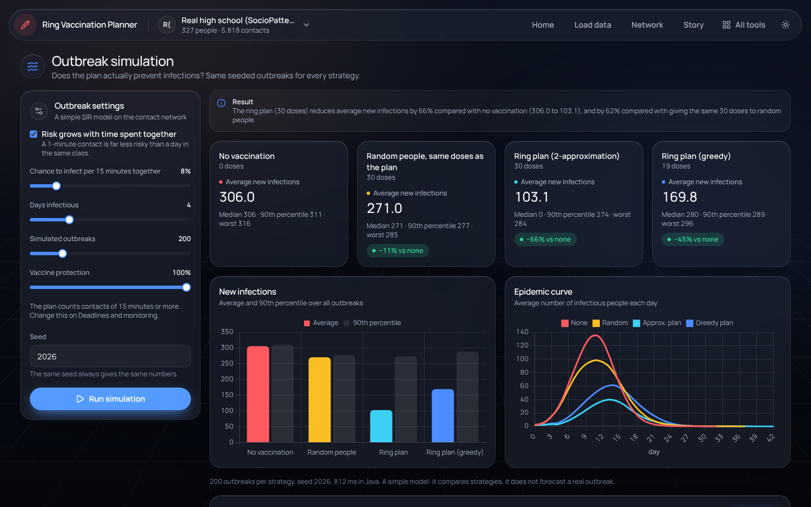

## Screenshots

| | |
|---|---|
| 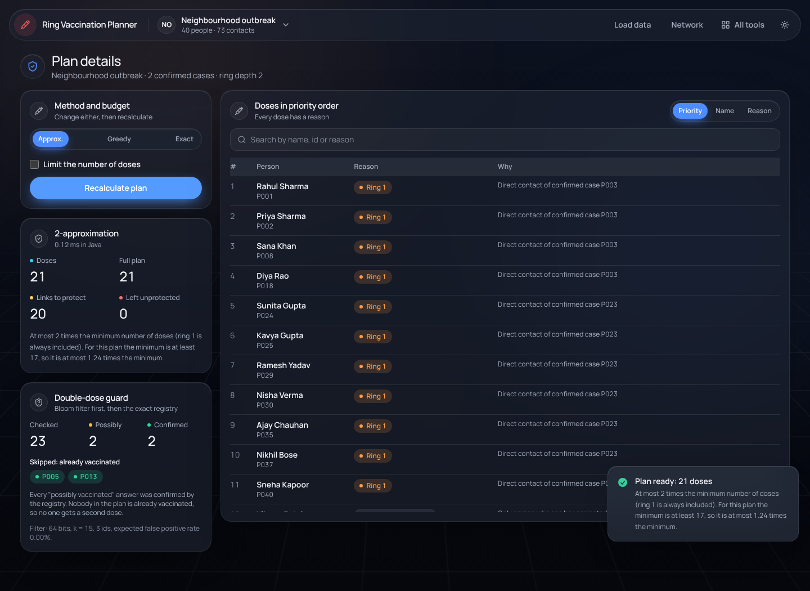 | 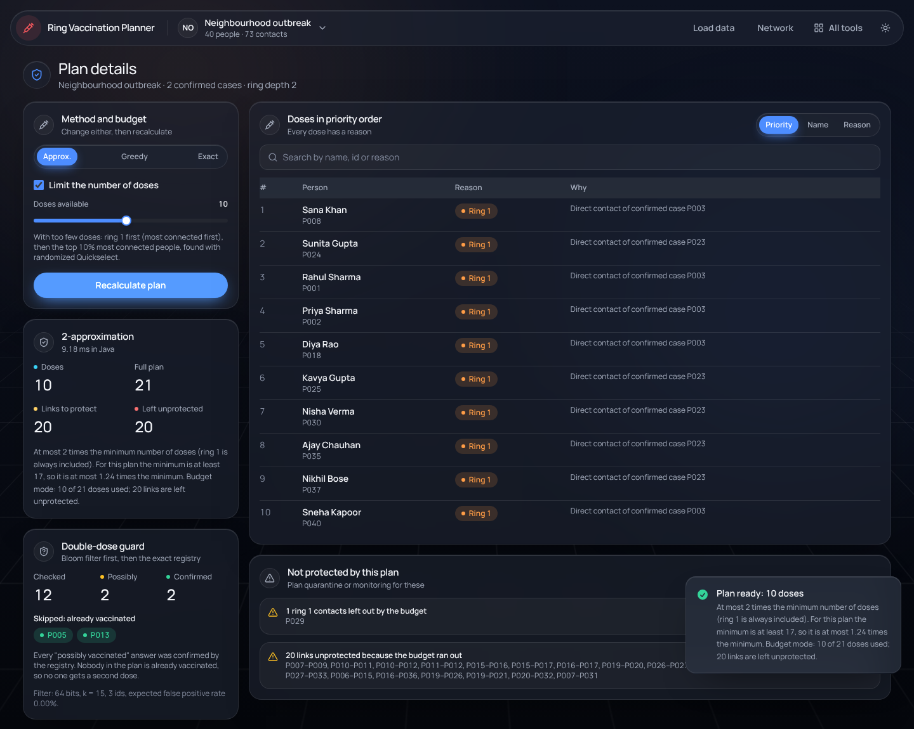 |
| 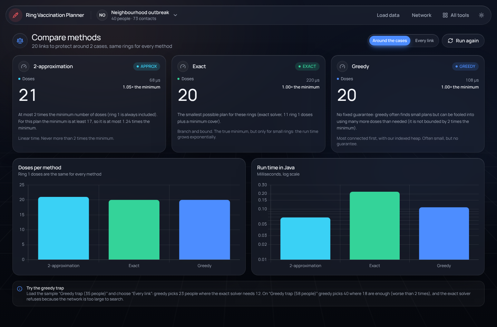 | 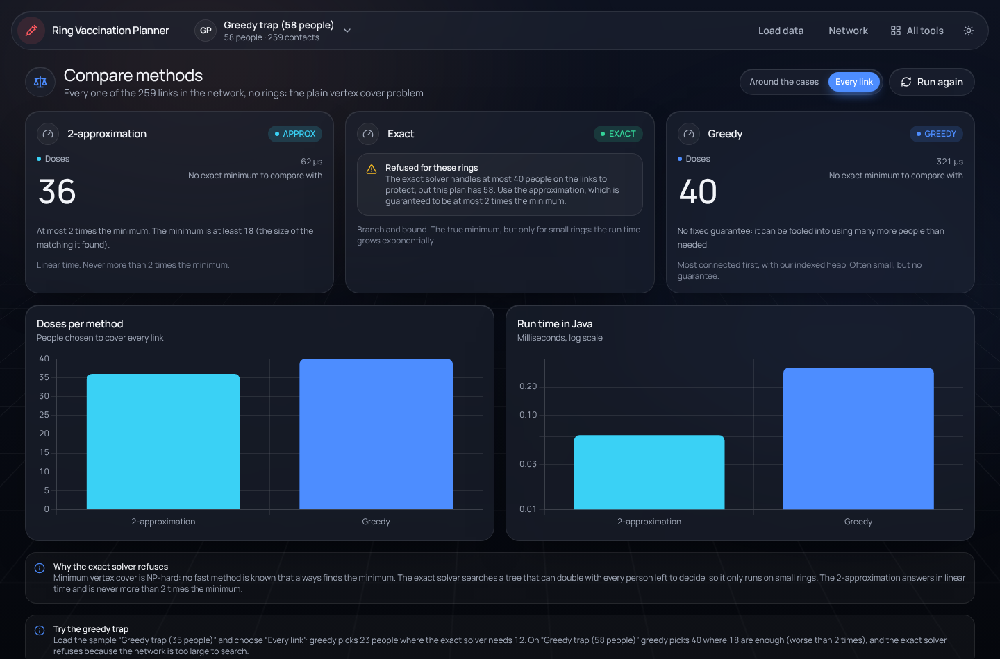 |
| 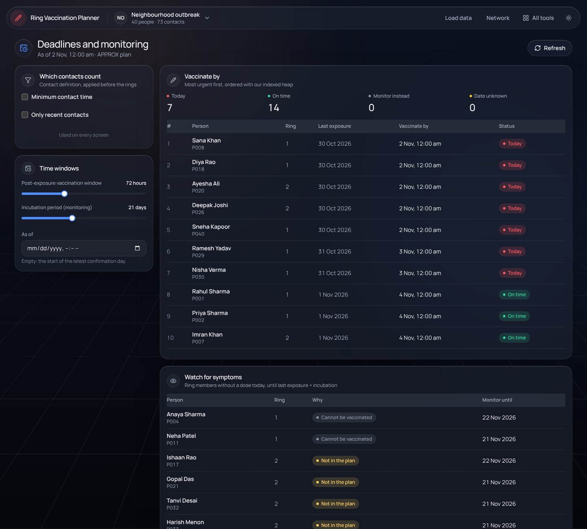 | 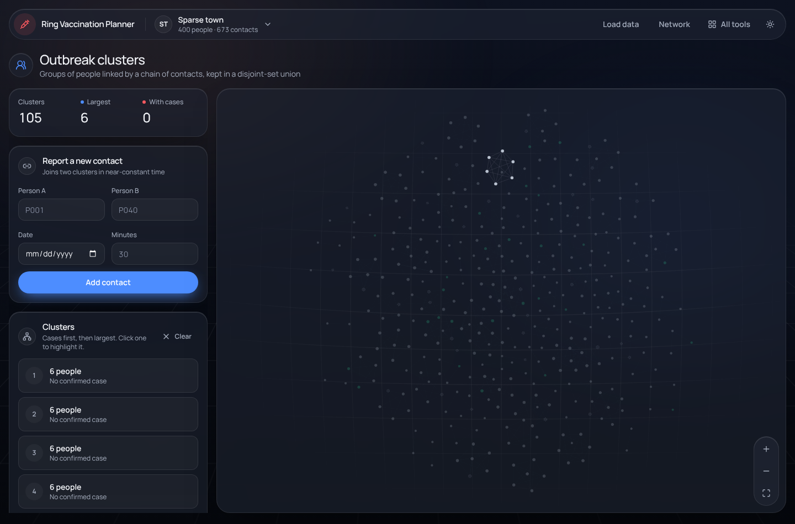 |
| 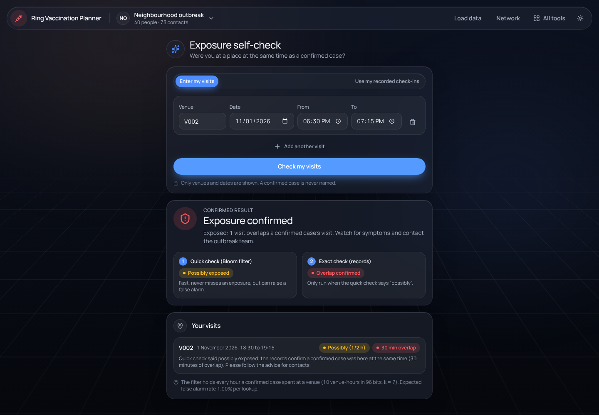 | 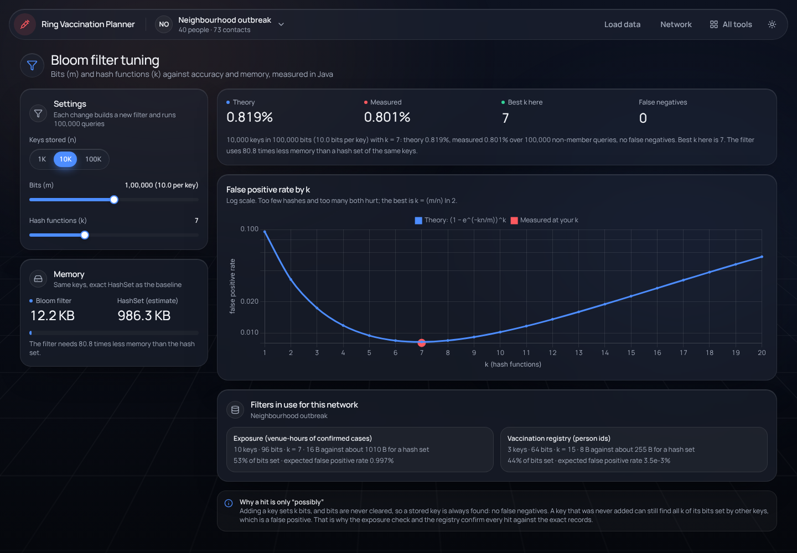 |
| 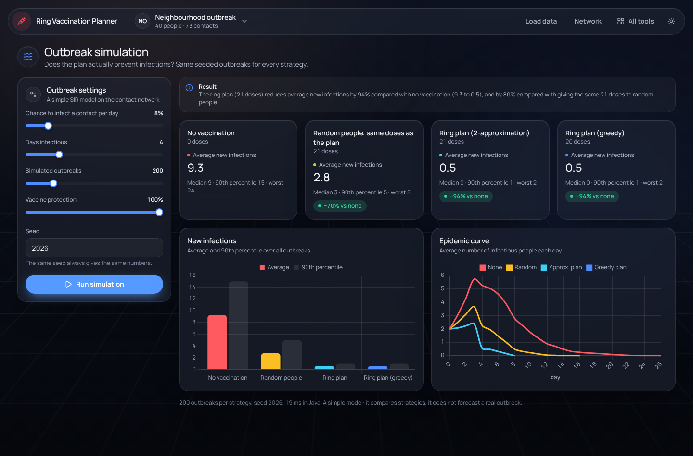 | 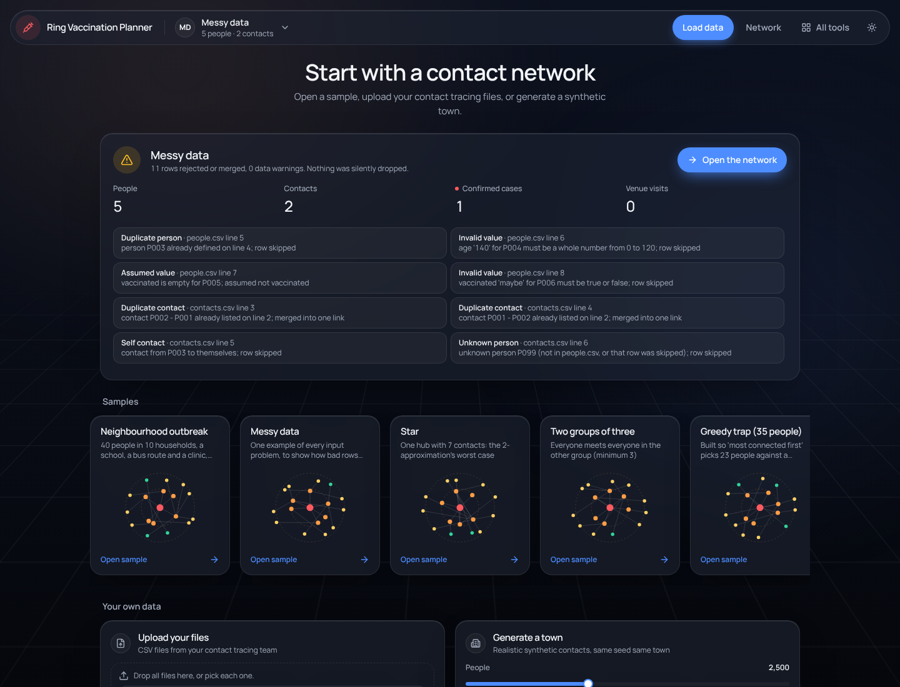 |

All screenshots are in [docs/screenshots](docs/screenshots), including the benchmarks page.

## Repository layout

```
backend/    Spring Boot API and the algorithm engine (all algorithms are written by us in Java)
frontend/   React app (input, configuration and results only; no algorithm logic)
data/       Sample CSV networks
docs/       Benchmark results and screenshots
```

## Limitations

- Networks are kept in memory; restarting the backend clears them.
- The simulation is a simple SIR model: one transmission probability for every contact, or one per 15 minutes of contact when risk is weighted by duration. It compares strategies; it does not forecast a real outbreak.
- The real network has real contacts but hypothetical cases: no public dataset pairs everyone's contacts with real infections.
- Vaccination is treated as fully protective in the plan (the simulation can lower the efficacy).
- Contact dates are days, so deadlines assume the exposure happened at the start of the day (the earliest, safest deadline).
